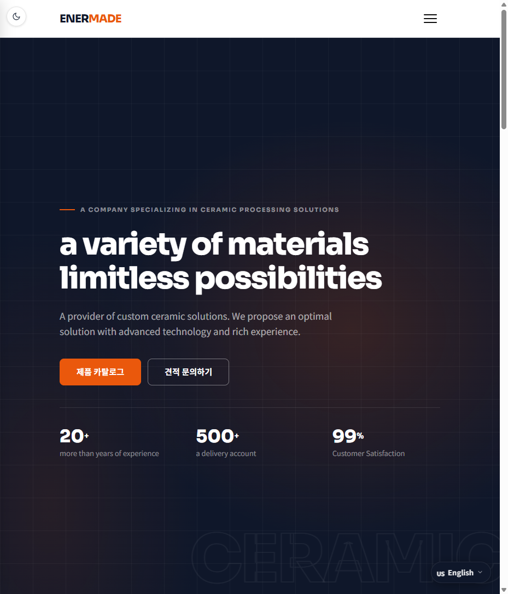
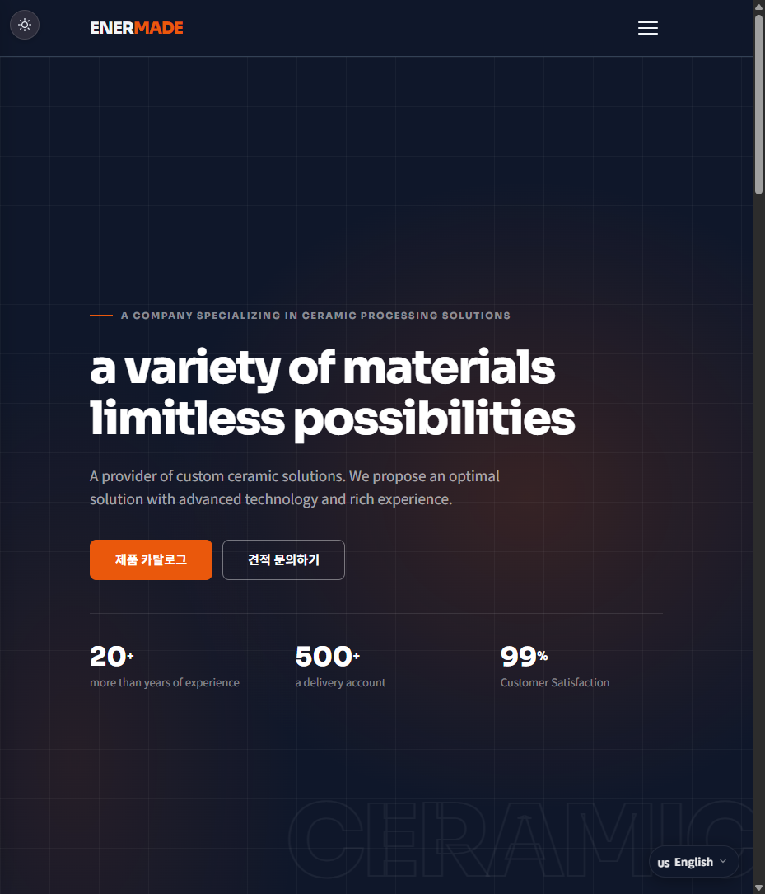
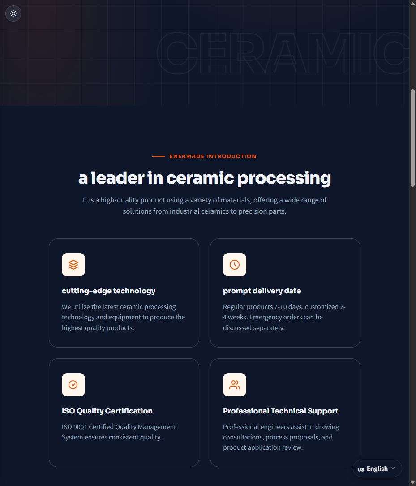
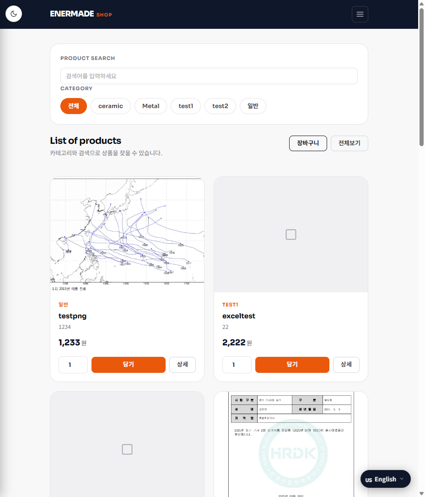
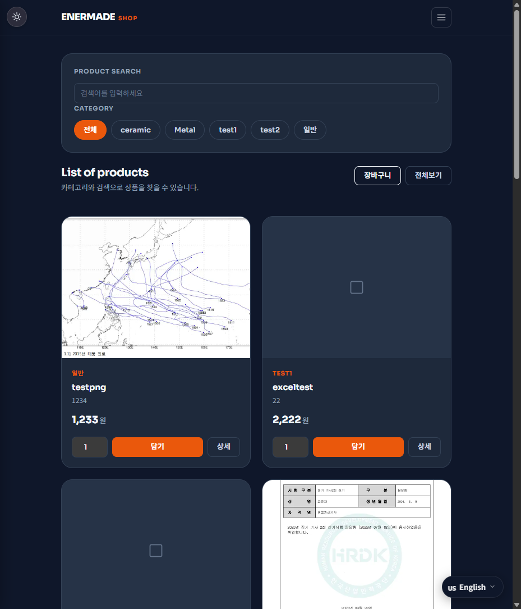

<div align="center">

# ENERMADE Company Website

**세라믹 가공 솔루션 전문기업의 풀스택 기업 웹사이트**

[](https://nodejs.org)
[](https://expressjs.com)
[](https://mysql.com)
[](https://pm2.keymetrics.io)
[](https://enermade.com)

</div>

---

## 📸 스크린샷

### 홈페이지 — 라이트 모드 / 영어 번역



---

### 홈페이지 — 다크 모드



---

### 다크 모드 — 기능 소개 섹션 (영문 번역 동시 적용)



---

### 쇼핑몰 — 라이트 모드 (영어 UI)



### 쇼핑몰 — 다크 모드



---

## 🛠 기술 스택

| 레이어 | 기술 |
|--------|------|
| **Runtime** | Node.js 18 |
| **Web Framework** | Express.js 4 |
| **Template Engine** | EJS |
| **Database** | MySQL 8 via `mysql2` Promise Pool |
| **CSS Framework** | Bootstrap 5 + Custom CSS Variables (다크 모드) |
| **Authentication** | express-session + bcrypt |
| **Payment** | Kakao Pay REST API |
| **Translation** | Naver Papago API (KO↔EN/JA/ZH 실시간) |
| **Email** | Nodemailer (Gmail SMTP) |
| **Process Manager** | PM2 |
| **Reverse Proxy** | Nginx |
| **Server** | Raspberry Pi (ARM64) |

---

## ✨ 주요 기능

### 🌙 다크 모드
- 헤더 토글 버튼으로 즉시 전환
- `[data-theme="dark"]` + CSS Custom Properties 시스템으로 전체 테마 일관 적용
- `--c-bg-navy` / `--c-navy` 역할 분리로 hero·footer는 항상 딥 네이비 유지
- `localStorage`에 설정 저장 → 페이지 이동 후에도 유지

### 🌐 다국어 실시간 번역 (KO / EN / JA / ZH)
- 우측 하단 언어 위젯으로 즉시 전환
- Naver Papago API를 서버 프록시(`/api/translate`)로 호출
- `data-i18n`, `data-i18n-html`, `data-i18n-placeholder` 명시 태그 지원
- **자동 스캔 시스템**: `<main>` 내 h1~h6, `.hero__eyebrow`, `.feat-card__title`, `.accordion-button` 등 정적 요소를 뷰 파일 수정 없이 전 페이지 자동 번역
- `h1 > em`, `h2 > br` 같은 인라인 자식 포함 헤딩 지원 — 번역 후 한국어 복원 시 `innerHTML` 원본 복구로 `<em>` 스타일 유지
- `localStorage` 캐시로 동일 텍스트 재번역 방지
- 인증 실패(401/403)만 전체 차단 — 개별 502는 건너뛰고 나머지 계속 번역

### 🛒 이커머스 쇼핑몰
- **카트**: 비로그인(세션) ↔ 로그인(DB) 이중 저장 + 로그인 시 자동 병합
- **결제**: Kakao Pay REST API 연동 (준비 → 승인 → 콜백 전 과정)
- **주문 조회**: 비회원도 주문번호 + 이름으로 조회 가능
- **상품 관리**: 어드민 대시보드에서 CRUD + Excel 일괄 업로드

### 🔐 인증 & 보안
- 세션 기반 인증 (`express-session`, 2시간 TTL, httpOnly)
- 비밀번호 bcrypt 해싱 (10 rounds)
- 커스텀 CSRF 미들웨어 (`/lib/csurf.js`) — `/auth`, `/admin` 라우트 적용
- Helmet.js 보안 헤더
- Nginx Reverse Proxy (`trust proxy` 설정)

### 👑 관리자 대시보드 (`/admin`)
- 상품 등록/수정/삭제 + 이미지 업로드
- Excel 파일로 상품 일괄 등록
- 주문 목록 조회 및 상태 관리
- 문의 답변 (이메일 알림 발송)
- 공지사항 관리

---

## 🗂 프로젝트 구조

```
company-site/
├── app.js                  # 엔트리포인트 — 미들웨어 체인
├── routes/
│   ├── company.js          # 홈, 소개, 공지, 문의
│   ├── auth.js             # 회원가입, 로그인, 비밀번호 찾기
│   ├── shop.js             # 상품, 장바구니, 결제
│   ├── admin.js            # 관리자 전용
│   └── api/                # REST API 엔드포인트
│       └── translate.js    # Papago 번역 프록시
├── services/
│   ├── papago.service.js   # Naver Papago API 래퍼
│   ├── kakao-pay.service.js
│   ├── email.service.js
│   └── notification.service.js
├── middleware/
│   └── auth.js             # requireLogin / requireAdmin 가드
├── lib/
│   ├── csurf.js            # 커스텀 CSRF 토큰
│   └── cart.js             # 세션/DB 이중 카트 로직
├── views/
│   ├── company/            # 기업 사이트 EJS 템플릿
│   ├── shop/               # 쇼핑몰 EJS 템플릿
│   ├── auth/               # 인증 페이지
│   └── admin/              # 관리자 대시보드
├── public/
│   ├── css/
│   │   ├── main.css        # CSS 변수 + 다크 모드 시스템
│   │   ├── company.css
│   │   └── shop.css
│   └── js/
│       └── main.js         # 다크모드 토글 + 번역 엔진
├── db.js                   # mysql2 Promise Pool
└── migrations/             # DB 스키마 마이그레이션
```

---

## ⚙️ 시작하기

### 사전 요구 사항

- Node.js 18+
- MySQL 8.0+

### 설치

```bash
git clone https://github.com/Hohongdu/company-site.git
cd company-site
npm install
cp .env.example .env
# .env 파일에 필요한 값 입력
```

### 환경변수 (`.env`)

```env
# 서버
SESSION_SECRET=your_secret_here
BASE_URL=https://yourdomain.com

# 데이터베이스
DB_HOST=127.0.0.1
DB_USER=your_db_user
DB_PASS=your_db_password
DB_NAME=company_site

# 이메일 (Gmail SMTP)
SMTP_HOST=smtp.gmail.com
SMTP_PORT=587
SMTP_USER=your@gmail.com
SMTP_PASS=your_app_password
EMAIL_FROM=your@gmail.com

# Kakao Pay
KAKAO_ADMIN_KEY=your_kakao_admin_key
KAKAO_CID=TC0ONETIME

# Naver Papago 번역 (선택)
PAPAGO_CLIENT_ID=your_papago_client_id
PAPAGO_CLIENT_SECRET=your_papago_secret
```

### 실행

```bash
npm run dev    # 개발 서버 (nodemon auto-reload)
npm start      # 프로덕션
npm test       # 테스트 (Node.js built-in test runner)
```

---

## 🚀 배포 구성

```
Internet → Nginx (80/443) → PM2 [company-site] (127.0.0.1:3000)
                                       ↓
                              MySQL (127.0.0.1:3306)
```

- **서버**: Raspberry Pi 4 (ARM64, Ubuntu Server)
- **프로세스**: PM2 `fork` 모드, 자동 재시작
- **HTTPS**: Let's Encrypt (Certbot)
- **정적 파일**: Express `static` → Nginx 캐싱

---

## 🔑 핵심 구현 포인트

### CSS 변수 이중 역할 분리 (다크 모드)

```css
:root {
  --c-bg-navy:  #0f172a;   /* 배경 전용 — 다크모드에서도 리매핑 안 됨 */
  --c-navy:     #0f172a;   /* 텍스트 전용 — 다크모드에서 #f1f5f9로 리매핑 */
}
[data-theme="dark"] {
  --c-navy: #f1f5f9;        /* 텍스트 색반전 */
  /* --c-bg-navy는 리매핑 없음 → hero/footer 항상 딥 네이비 유지 */
}
```

### 번역 인라인 자식 보존

```js
// h1 > em 처럼 인라인 자식이 있어도 번역 허용
if (el.children.length > 0 && !hasOnlyInlineChildren(el)) return;

// 한국어 복원 시 innerHTML 원본 복구 (em 스타일 유지)
const htmlKo = el.getAttribute('data-i18n-auto-html-ko');
if (htmlKo) el.innerHTML = htmlKo;
else if (src) el.textContent = src;
```

### 카트 세션↔DB 이중 저장

```js
// lib/cart.js — 로그인 시 세션 카트를 DB로 병합
async function mergeCarts(sessionCart, userId) { ... }
```

---

<div align="center">

**© 2026 ENERMADE** · Built with Express.js + MySQL on Raspberry Pi

</div>
